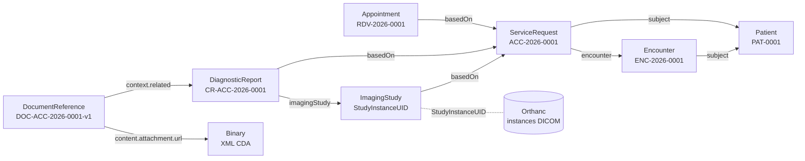

# 01 · Identifiants et traçabilité

> Critère de réussite du cahier des charges : *« le patient, la consultation, la prescription, le rendez-vous RIS,
> l'étude PACS et le compte rendu sont liés par des identifiants cohérents et traçables »*.

Ce document est la **règle commune aux trois membres**. Tout nouveau composant doit la respecter.

## 1. Les identifiants métier

| Objet | Format | Exemple | Créé par |
|---|---|---|---|
| Patient | `PAT-NNNN` | `PAT-0001` | SIH (A) |
| Professionnel | `PRA-NNNN` | `PRA-0002` | Administration (C) |
| Consultation | `ENC-AAAA-NNNN` | `ENC-2026-0001` | SIH (A) |
| **Examen (numéro d'examen)** | `ACC-AAAA-NNNN` | `ACC-2026-0001` | SIH (A), au moment de la prescription |
| Rendez-vous RIS | `RDV-AAAA-NNNN` | `RDV-2026-0001` | RIS (B) |
| Étude DICOM | Study Instance UID | `<racine>.6.1.20260001` | RIS (B), à la programmation |
| Compte rendu | `CR-ACC-AAAA-NNNN` | `CR-ACC-2026-0001` | RIS (B) |
| Document CDA | `DOC-ACC-AAAA-NNNN-vN` | `DOC-ACC-2026-0001-v1` | Connecteur CDA (B) |

Le **numéro d'examen** (`ACC-…`, *accession number*) est le fil rouge : il est créé une seule fois et recopié partout.

## 2. Où chaque identifiant apparaît

| Identifiant | FHIR R4 | DICOM (Orthanc) | CDA R2 |
|---|---|---|---|
| `PAT-0001` | `Patient.identifier` (system `http://sih-its.local/sid/patient`) | `PatientID (0010,0020)` + `IssuerOfPatientID = SIH-ITS` | `recordTarget/patientRole/id` (root `<racine>.1`) |
| `ENC-2026-0001` | `Encounter.identifier` | – | `componentOf/encompassingEncounter/id` (root `<racine>.5`) |
| `ACC-2026-0001` | `ServiceRequest.identifier` (type `ACSN`) et `ImagingStudy.identifier` (type `ACSN`) | `AccessionNumber (0008,0050)` | `inFulfillmentOf/order/id` (root `<racine>.2`) |
| Study Instance UID | `ImagingStudy.identifier` (system `urn:dicom:uid`, valeur `urn:oid:…`) | `StudyInstanceUID (0020,000D)` | `documentationOf/serviceEvent/id` |
| `PRA-0002` (radiologue) | `DiagnosticReport.resultsInterpreter`, `DocumentReference.author` | – | `author/assignedAuthor/id`, `legalAuthenticator` (root `<racine>.4`) |
| `DOC-ACC-2026-0001-v1` | `DocumentReference.masterIdentifier` | – | `ClinicalDocument/id` (root `<racine>.3`) |

Les **références FHIR** relient ensuite les ressources entre elles :



## 3. Racine OID du projet

Le CDA et le DICOM exigent des OID. Le groupe utilise une racine unique générée à partir d'un UUID
(arc `2.25`, qui ne nécessite aucun enregistrement) :

```
<racine> = 2.25.15160578678088058174301844912568396362
```

| Usage | OID |
|---|---|
| Patients | `<racine>.1` |
| Numéros d'examen | `<racine>.2` |
| Documents CDA | `<racine>.3` |
| Professionnels | `<racine>.4` |
| Consultations | `<racine>.5` |
| UID d'étude DICOM | `<racine>.6.1.<chiffres du numéro d'examen>` |
| Établissement | `<racine>.7` |

**Règle du Study Instance UID** : `ACC-2026-0001` → `<racine>.6.1.20260001` (55 caractères, la limite DICOM est 64).
Le RIS le calcule dès la programmation et le transmet à la modalité par la worklist.
Ainsi, l'étude reçue par Orthanc porte déjà le bon UID, sans table de correspondance à maintenir.

## 4. L'identifiant interne d'Orthanc

Orthanc attribue aussi son propre identifiant à chaque étude (une empreinte du type `27f7126f-4f66fb14-…`).
Il ne fait **pas** partie des identifiants métier : le RIS le retrouve à la demande avec

```http
POST /tools/find
{ "Level": "Study", "Query": { "AccessionNumber": "ACC-2026-0001" } }
```

puis s'en sert pour construire le lien vers la visionneuse.

## 5. Ce qu'il faut montrer en démonstration

1. Le même `ACC-2026-0001` dans le SIH, le RIS, Orthanc (colonne *Accession number*) et le CDA.
2. Le même Study Instance UID dans Orthanc, dans `ImagingStudy` et dans le CDA.
3. Une tentative de rattachement à un patient inexistant refusée (voir `interop/fhir/requetes.http`, tests négatifs).
