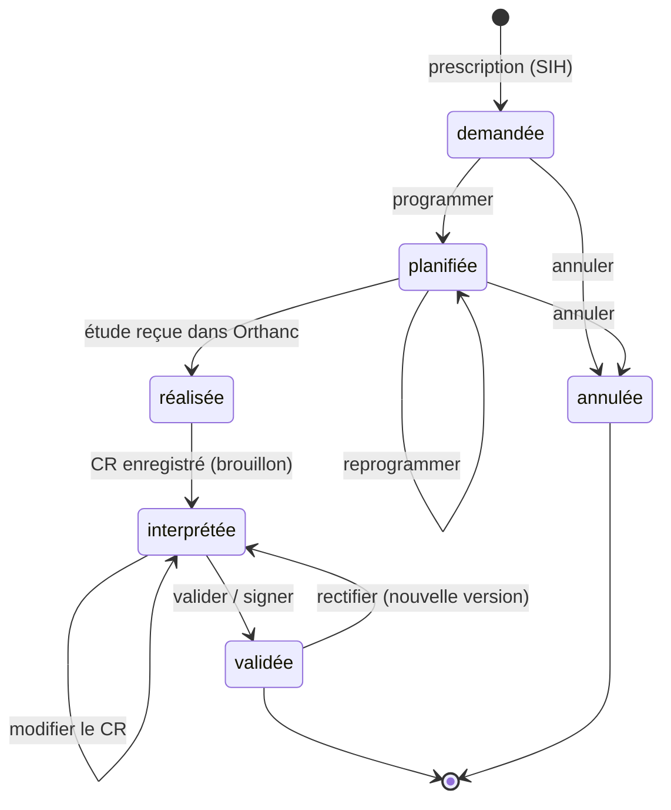

# 02 · Cycle de vie d'une demande dans le RIS

> Cahier des charges, §6 : *« demandée → planifiée → réalisée → interprétée → validée. Les transitions autorisées
> doivent être définies. Une demande annulée doit être distinguée d'un examen terminé. »*

## 1. Diagramme d'états



## 2. Transitions autorisées

| De → vers | Qui | Déclencheur | Effets FHIR |
|---|---|---|---|
| *(aucun)* → **demandée** | Médecin (SIH) | Prescription | `ServiceRequest` créé, `status = active` |
| demandée → **planifiée** | Radiologue / secrétariat radio (RIS) | Choix du créneau et de la salle | `Appointment` créé, `status = booked` ; entrée de worklist déposée (extension) |
| planifiée → planifiée | RIS | Reprogrammation | `Appointment.start/end` modifiés ; worklist régénérée |
| planifiée → **réalisée** | RIS (automatique ou bouton « vérifier ») | Étude retrouvée dans Orthanc par `AccessionNumber` | `ImagingStudy` créé (`available`) ; `Appointment.status = fulfilled` ; worklist supprimée |
| réalisée → **interprétée** | Radiologue | CR enregistré | `DiagnosticReport` créé, `status = preliminary` |
| interprétée → **validée** | Radiologue uniquement | Validation (signature) | `DiagnosticReport.status = final` ; CDA généré ; `Binary` + `DocumentReference` (`current`) créés ; `ServiceRequest.status = completed` |
| validée → interprétée | Radiologue | Rectification | `DiagnosticReport.status = amended` à la revalidation ; nouveau CDA `v2` ; l'ancien `DocumentReference` passe à `superseded` |
| demandée/planifiée → **annulée** | Médecin ou RIS | Annulation | `ServiceRequest.status = revoked` ; `Appointment.status = cancelled` (+ `cancelationReason`) ; worklist supprimée |

## 3. Transitions interdites (à tester)

| Tentative | Réponse attendue |
|---|---|
| demandée → réalisée (sans programmation) | Refus : « l'examen doit être programmé » |
| réalisée → validée (sans CR) | Refus : « aucun compte rendu à valider » |
| annulée → planifiée | Refus : une demande annulée est définitive ; il faut une nouvelle prescription |
| réalisée → annulée | Refus : un examen déjà réalisé ne s'annule pas (l'étude existe dans le PACS) |
| validation par un rôle autre que radiologue | Refus 403 + trace dans les journaux |
| toute transition non listée au §2 | Refus avec message explicite |

**Annulée ≠ terminée** : une demande annulée a `ServiceRequest.status = revoked` et aucun `DiagnosticReport`.
Une demande terminée a `ServiceRequest.status = completed` et un `DiagnosticReport` `final`.

## 4. Conseil d'implémentation

Coder les transitions dans **un seul endroit** du RIS (par exemple `services/ris/src/domaine/etats`), sous forme de table :

```text
TRANSITIONS = {
  demandee:    [planifiee, annulee],
  planifiee:   [planifiee, realisee, annulee],
  realisee:    [interpretee],
  interpretee: [interpretee, validee],
  validee:     [interpretee],
  annulee:     []
}
```

Toute demande de changement d'état passe par une fonction `changer_etat(demande, nouvel_etat, utilisateur)`, qui
vérifie la table et le rôle, journalise l'action, puis appelle le serveur FHIR. Les tests unitaires portent sur cette fonction.
