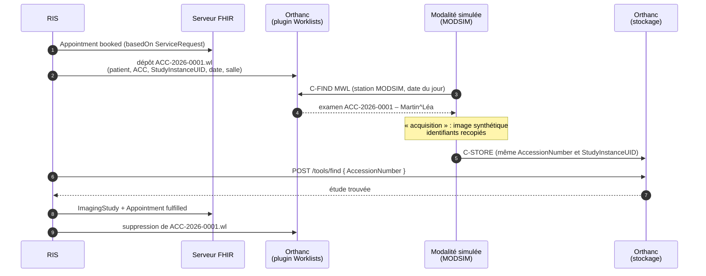

# 04 · Extension : worklist DICOM et modalité simulée

> Cahier des charges, §3 (extensions) : *« Worklist DICOM et modalité simulée, en coordination avec la partie PACS/DICOM. »*

## 1. Pourquoi c'est utile

Sans worklist, le manipulateur ressaisit le nom du patient et le numéro d'examen sur l'appareil : risque de faute de frappe,
et l'étude arrive dans le PACS sans lien fiable avec la demande.
Avec une **worklist (MWL, *Modality Worklist*)**, l'appareil **interroge** le système, reçoit la liste des examens prévus
et **recopie** les identifiants dans les images. C'est le maillon qui garantit :

```
ServiceRequest (ACC-2026-0001)  ==  AccessionNumber de l'étude DICOM  ==  ImagingStudy  ==  CDA
```

## 2. Principe



## 3. Correspondance FHIR → worklist DICOM

| Attribut DICOM (MWL) | Tag | Source FHIR |
|---|---|---|
| PatientName | (0010,0010) | `Patient.name` → `Martin^Léa` |
| PatientID / IssuerOfPatientID | (0010,0020) / (0010,0021) | `Patient.identifier` → `PAT-0001` / `SIH-ITS` |
| PatientBirthDate, PatientSex | (0010,0030), (0010,0040) | `Patient.birthDate`, `Patient.gender` |
| **AccessionNumber** | (0008,0050) | `ServiceRequest.identifier` (type ACSN) |
| ReferringPhysicianName | (0008,0090) | `ServiceRequest.requester` → `Practitioner.name` |
| **StudyInstanceUID** | (0020,000D) | calculé : `<racine>.6.1.<chiffres de ACC>` (voir 01-identifiants) |
| RequestedProcedureID / Description | (0040,1001) / (0032,1060) | numéro d'examen / `ServiceRequest.code.text` |
| RequestedProcedureCodeSequence | (0032,1064) | `ServiceRequest.code.coding` (LOINC) |
| ReasonForTheRequestedProcedure | (0040,1002) | `ServiceRequest.reasonCode.text` |
| ScheduledProcedureStepSequence › Modality | (0008,0060) | type d'appareil (`CR`) |
| › ScheduledStationAETitle | (0040,0001) | AE Title de l'appareil (`MODSIM`) |
| › ScheduledProcedureStepStartDate / Time | (0040,0002) / (0040,0003) | `Appointment.start` |
| › ScheduledProcedureStepLocation | (0040,0011) | `Appointment.participant` (Location) |
| › ScheduledProcedureStepID | (0040,0009) | `SPS-2026-0001` |

## 4. Mise en œuvre dans le projet

| Élément | Fichier |
|---|---|
| Activation du plugin Worklists d'Orthanc, déclaration de la modalité `MODSIM` | `docker-compose.yml` (`WORKLISTS_PLUGIN_ENABLED`, `ORTHANC__DICOM_MODALITIES`) |
| Dossier partagé RIS ↔ Orthanc | `interop/dicom/worklists/` monté dans `/var/lib/orthanc/worklists` |
| Création / suppression d'une entrée | `interop/dicom/modalite-simulee/creer_worklist.py` |
| Modalité simulée (C-FIND puis C-STORE) | `interop/dicom/modalite-simulee/modalite.py` |

Sur les 3 VM, Orthanc est sur la **VM3** : le RIS (VM2) doit pouvoir y déposer les fichiers `.wl`
(dossier partagé, ou petit service sur la VM3). La modalité simulée tourne sur la VM2 ou sur un PC, et le port DICOM 4242
de la VM3 n'est ouvert qu'à elle.

## 5. Lancer la démonstration

```bash
cd interop/dicom/modalite-simulee
python3 -m venv .venv && source .venv/bin/activate
pip install -r requirements.txt

# 1. Le RIS programme l'examen -> entrée de worklist
python creer_worklist.py --fhir http://localhost:8080/fhir --accession ACC-2026-0001
#    (sans serveur FHIR : --bundle ../../fhir/scenario-complet.json)

# 2. La modalité consulte sa worklist
python modalite.py --lister --date toutes

# 3. « Acquisition » et envoi à Orthanc
python modalite.py --accession ACC-2026-0001 --date toutes

# 4. Après passage à « réalisée » : retrait de l'entrée
python creer_worklist.py --supprimer --accession ACC-2026-0001
```

Les deux scripts ont été testés de bout en bout contre un PACS de test (pynetdicom) : l'image reçue porte bien
le même `PatientID`, `AccessionNumber` et `StudyInstanceUID` que la worklist et que l'`ImagingStudy` FHIR.
**À refaire avec Orthanc** une fois `docker compose up -d` lancé.

L'image générée est **synthétique** (formes géométriques) : aucune donnée réelle, réutilisable sans contrainte de licence,
ce qui répond à l'exigence « études DICOM de démonstration réutilisables légalement ».

## 6. Tests et cas d'échec

| Cas | Comportement attendu |
|---|---|
| Demande annulée (`revoked`) | `creer_worklist.py` refuse de créer l'entrée |
| Demande pas encore programmée | `creer_worklist.py` refuse (« aucun Appointment actif ») |
| Modalité non déclarée dans Orthanc | C-FIND refusé, message explicite |
| Orthanc arrêté (PACS indisponible) | La modalité s'arrête avec un message ; le RIS reste utilisable et l'examen reste « planifié » |
| Mauvaise date | Liste vide : utiliser `--date AAAAMMJJ` ou `--date toutes` |

## 7. Dépannage

- **Liste toujours vide** : vérifier que le fichier `.wl` est bien dans `interop/dicom/worklists/` et consulter
  les journaux : `docker compose logs orthanc | grep -i worklist`.
- **Association refusée** : l'AE Title `MODSIM` doit être déclaré dans `ORTHANC__DICOM_MODALITIES`.
- Outil de contrôle indépendant (DCMTK, `brew install dcmtk` sur Mac) :
  `findscu -W -aet MODSIM -aec ORTHANC localhost 4242 -k "ScheduledProcedureStepSequence[0].Modality=CR"`
