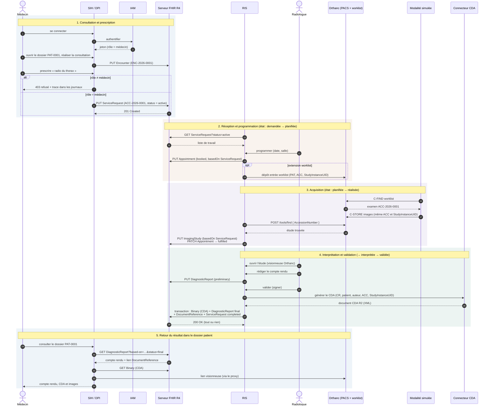

# 05 · Diagramme de séquence : de la prescription au résultat

> Cahier des charges, §7 : *« UML – séquence : cheminement d'une demande d'imagerie, de la prescription au résultat. »*

Version éditable pour le rapport : `docs/uml/sequence-prescription-resultat.drawio` (s'ouvre dans draw.io ou dans VS Code
avec l'extension *Draw.io Integration*). La version ci-dessous s'affiche directement sur GitHub.

## Lecture du diagramme

| Phase | Ce qui est démontré | Ressources / échanges |
|---|---|---|
| 1. Prescription | Authentification, contrôle du rôle, refus tracé | `Encounter`, `ServiceRequest` (FHIR) |
| 2. Programmation | La demande arrive dans le RIS sans ressaisie | `Appointment` (FHIR), entrée de worklist (DICOM) |
| 3. Acquisition | L'étude porte les identifiants de la demande | C-FIND / C-STORE (DICOM), `ImagingStudy` (FHIR) |
| 4. Validation | Seul le radiologue valide ; CR et document enregistrés ensemble | `DiagnosticReport`, `Binary`, `DocumentReference` (FHIR), CDA R2 |
| 5. Retour | Le médecin retrouve CR, CDA et images dans le même dossier | Recherches FHIR, visionneuse Orthanc |

Cette séquence correspond au déroulé de démonstration du cahier des charges (§9).
Les flèches indiquent une progression fonctionnelle : en pratique, le RIS peut interroger le serveur FHIR à intervalles
réguliers (*polling*) plutôt que d'être notifié.
